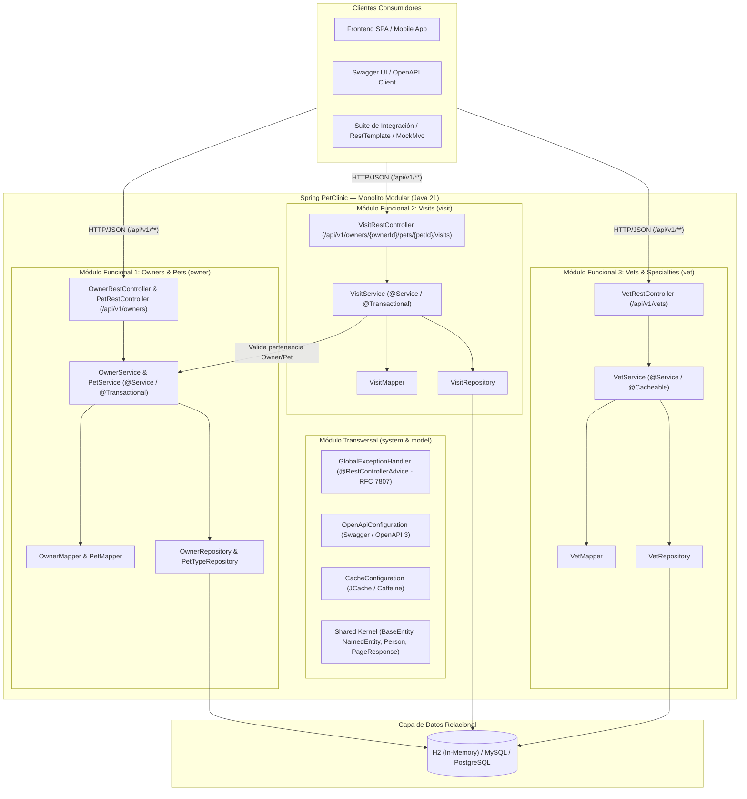
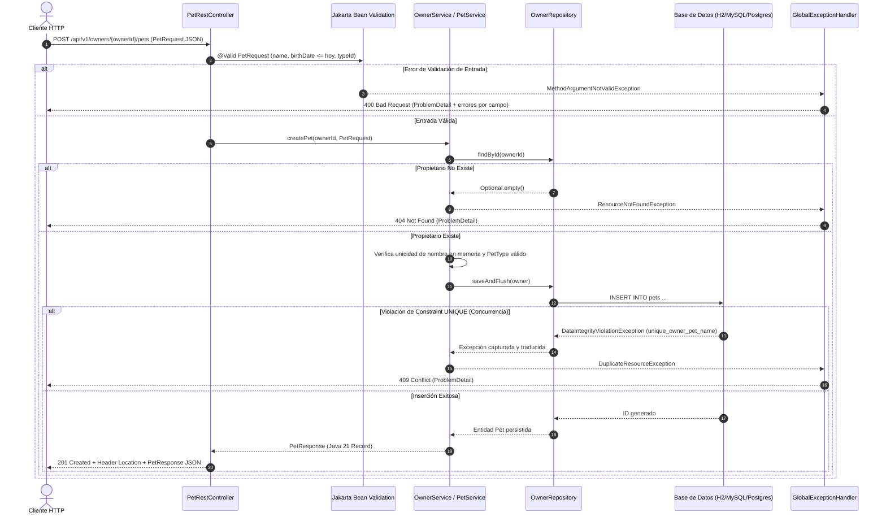
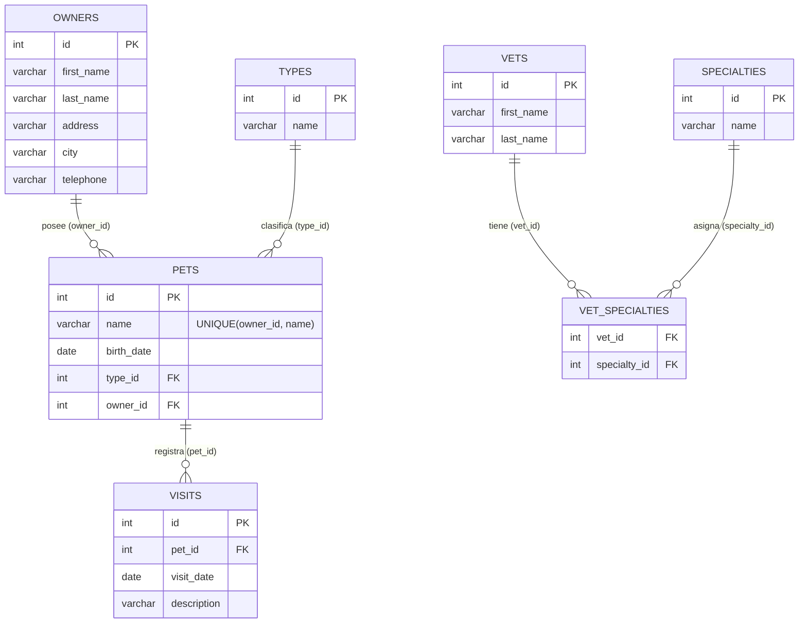

# 02. Arquitectura Objetivo — Monolito Modular REST con Java 21

**Fecha de diseño:** 2026-11-11  
**Rol:** Arquitecto de Software Senior / Tech Lead  
**Estilo Arquitectónico:** Monolito Modular (*Modular Monolith*) + API RESTful JSON (`/api/v1/...`)  
**Stack Objetivo:** Java 21 LTS + Spring Boot 4.1.0 + Spring Data JPA + Bean Validation + SpringDoc OpenAPI 3

---

## 1. Visión Arquitectónica

La modernización reemplaza por completo la capa de presentación acoplada a **Thymeleaf (SSR)** por una **API REST/JSON sin estado (Stateless)** bajo el prefijo versionado `/api/v1`. El sistema se estructura internamente como un **Monolito Modular**, dividiendo el dominio en módulos funcionales con límites bien definidos, capas internas desacopladas (Controladores REST -> Servicios de Aplicación/Dominio -> Repositorios JPA) y separación estricta entre **DTOs inmutables (`record` de Java 21)** y **Entidades de Persistencia JPA**.

---

## 2. Diagramas de Arquitectura (Mermaid)

### 2.1. Diagrama de Componentes y Módulos del Sistema



### 2.2. Diagrama de Secuencia: Creación de Mascota con Validación y Control de Concurrencia



### 2.3. Diagrama Entidad-Relación (Esquema Relacional Preservado)



---

## 3. Límites de Módulos y Estructura de Paquetes

El diseño divide el monolito en **tres módulos de negocio** y **un módulo transversal (`system` + `model`)**:

```text
org.springframework.samples.petclinic
├── PetClinicApplication.java
├── PetClinicRuntimeHints.java
├── model/                                      # [Shared Kernel]
│   ├── BaseEntity.java
│   ├── NamedEntity.java
│   ├── Person.java
│   └── dto/
│       └── PageResponse.java                   # Record genérico de paginación REST
├── system/                                     # [Infraestructura Transversal]
│   ├── CacheConfiguration.java
│   ├── OpenApiConfiguration.java               # Configuración de metadatos OpenAPI 3 / Swagger
│   └── exception/
│       ├── ResourceNotFoundException.java      # HTTP 404
│       ├── DuplicateResourceException.java     # HTTP 409
│       ├── BusinessRuleException.java          # HTTP 400 / 422
│       └── GlobalExceptionHandler.java         # @RestControllerAdvice -> ProblemDetail (RFC 7807)
├── owner/                                      # [Módulo 1: Owners & Pets]
│   ├── Owner.java                              # Entidad JPA
│   ├── Pet.java                                # Entidad JPA
│   ├── PetType.java                            # Entidad JPA
│   ├── OwnerRepository.java                    # Repositorio JPA
│   ├── PetTypeRepository.java                  # Repositorio JPA
│   ├── service/
│   │   └── OwnerPetService.java                # Lógica de negocio de propietarios, mascotas y tipos
│   ├── mapper/
│   │   └── OwnerPetMapper.java                 # Conversión limpia Entidad <-> Record DTO
│   ├── dto/
│   │   ├── OwnerRequest.java                   # Java 21 Record con Bean Validation
│   │   ├── OwnerResponse.java                  # Java 21 Record
│   │   ├── PetRequest.java                     # Java 21 Record con Bean Validation
│   │   ├── PetResponse.java                    # Java 21 Record
│   │   └── PetTypeResponse.java                # Java 21 Record
│   └── api/
│       ├── OwnerRestController.java            # /api/v1/owners
│       ├── PetRestController.java              # /api/v1/owners/{ownerId}/pets
│       └── PetTypeRestController.java          # /api/v1/pet-types
├── visit/                                      # [Módulo 2: Visits]
│   ├── Visit.java                              # Entidad JPA (movida o referenciada limpiamente)
│   ├── VisitRepository.java                    # Repositorio JPA dedicado para consultas/operaciones
│   ├── service/
│   │   └── VisitService.java                   # Lógica de agendamiento de visitas
│   ├── mapper/
│   │   └── VisitMapper.java                    # Conversión Visit <-> VisitResponse
│   ├── dto/
│   │   ├── VisitRequest.java                   # Java 21 Record (@Future date, @NotBlank description)
│   │   └── VisitResponse.java                  # Java 21 Record
│   └── api/
│       └── VisitRestController.java            # /api/v1/owners/{ownerId}/pets/{petId}/visits
└── vet/                                        # [Módulo 3: Vets & Specialties]
    ├── Vet.java                                # Entidad JPA
    ├── Specialty.java                          # Entidad JPA
    ├── VetRepository.java                      # Repositorio con caché "vets"
    ├── service/
    │   └── VetService.java                     # Servicio de consulta de veterinarios
    ├── mapper/
    │   └── VetMapper.java                      # Conversión Vet <-> VetResponse
    ├── dto/
    │   ├── VetResponse.java                    # Java 21 Record
    │   └── SpecialtyResponse.java              # Java 21 Record
    └── api/
        └── VetRestController.java              # /api/v1/vets
```

### Reglas de Comunicación Inter-Módulos
1. **Prohibición de acceso cruzado directo a Repositorios:** El módulo `visit` no modifica directamente tablas de `owner` sin pasar por el servicio o agregado correspondiente (`OwnerPetService`), preservando la integridad del agregado `Owner -> Pet -> Visit`.
2. **Prohibición de fugas de Entidades JPA en la capa API:** Ningún `@RestController` puede recibir ni devolver clases anotadas con `@Entity` (`Owner`, `Pet`, `Visit`, `Vet`, `PetType`, `Specialty`). Solo se permiten DTOs inmutables (`record`).
3. **Independencia de la capa Web Legacy:** Se eliminan las dependencias de `spring-boot-starter-thymeleaf` y `webjars`, así como los controladores de vistas HTML, `PetTypeFormatter` y `PetValidator` imperativo.

---

## 4. Decisiones Técnicas de Arquitectura (ADRs)

### ADR-00: Elección de Monolito Modular frente a Microservicios Distribuidos
- **Contexto:** La prueba técnica permite elegir entre un **Monolito Modular bien delimitado** o una arquitectura de **Microservicios desplegables por separado**, exigiendo justificar la decisión y las alternativas descartadas.
- **Alternativa Descartada (Microservicios Distribuidos):** Dividir PetClinic en múltiples procesos independientes (`owners-service`, `visits-service`, `vets-service`) con bases de datos separadas introduciría sobrecarga operativa innecesaria (transacciones distribuidas / Saga para validar que un `Visit` pertenezca a un `Pet` y `Owner` válidos, latencia de red inter-servicio, duplicación de configuración y despliegue multi-contenedor) para un dominio cuyo volumen transaccional y cohesión de datos son fuertemente locales.
- **Decisión:** Adoptar un **Monolito Modular** sobre Spring Boot 4.1 y Java 21 con tres módulos funcionales claramente separados (`owner`, `visit`, `vet`) y un núcleo compartido (`model`, `system`).
- **Justificación:**
  1. **Consistencia Transaccional ACID:** La creación de mascotas (`unique_owner_pet_name`) y visitas requiere garantías inmediatas de integridad referencial y control de concurrencia sobre el agregado `Owner -> Pet -> Visit`.
  2. **Fronteras Lógicas Estrictas:** Cada módulo posee su propia capa `api` (`@RestController`), `service` (`@Service`), `mapper` (`@Component`) y `dto` (`record`), comunicándose mediante servicios de dominio y nunca exponiendo entidades JPA hacia el exterior.
  3. **Evolucionabilidad:** Si en el futuro el módulo `vet` o `visit` requiriera escalado independiente, sus contratos REST (`/api/v1/vets`, `/api/v1/owners/{ownerId}/pets/{petId}/visits`) y su capa de servicio ya están desacoplados para extraerse sin alterar el contrato público.

### ADR-01: Adopción de Java 21 LTS y `record` para DTOs
- **Contexto:** El proyecto base está configurado en Java 17 y utiliza clases mutables JavaBean para todo el flujo de datos.
- **Decisión:** Actualizar el compilador y runtime a **Java 21** (`<java.version>21</java.version>`) y definir todos los DTOs de entrada/salida (`*Request`, `*Response`, `PageResponse<T>`) como `record` de Java.
- **Justificación:** Los `record` garantizan inmutabilidad superficial por defecto, eliminan código repetitivo (*boilerplate*), se integran de forma nativa con Jackson y Jakarta Bean Validation en componentes de constructor, y previenen mutaciones accidentales entre capas.

### ADR-02: Reemplazo Total de Thymeleaf por API REST Versionada (`/api/v1/...`)
- **Contexto:** La aplicación original mezcla rutas HTML (`/owners/new`, `/owners/{id}/edit`, `/vets.html`) con redirecciones `302` dependientes de la cantidad de registros encontrados.
- **Decisión:** Eliminar el motor de plantillas Thymeleaf y exponer todos los recursos bajo `/api/v1/...` siguiendo convenciones REST estrictas (`GET`, `POST`, `PUT`, códigos `200`, `201`, `400`, `404`, `409`).
- **Justificación:** Unifica el contrato del backend en JSON, elimina la sobrecarga de dependencias de interfaz gráfica (`thymeleaf`, `bootstrap`, `font-awesome`) y permite que cualquier cliente moderno (React, Angular, Mobile, integraciones B2B) consuma la API de manera predecible.

### ADR-03: Estandarización de Errores con RFC 7807 (`ProblemDetail`)
- **Contexto:** En el sistema legacy, los errores de validación devuelven vistas HTML `200 OK` con atributos en `BindingResult`, y las entidades no encontradas lanzan `IllegalArgumentException` no controladas.
- **Decisión:** Implementar `GlobalExceptionHandler` con `@RestControllerAdvice` utilizando la clase estándar `org.springframework.http.ProblemDetail` (RFC 7807 / RFC 9457) nativa de Spring Framework 6/7.
- **Mapeo de Códigos HTTP:**
  - `400 Bad Request`: Errores de validación de campos (`MethodArgumentNotValidException`, `ConstraintViolationException`) o desajuste de parámetros, incluyendo un mapa detallado `errors` con los campos rechazados.
  - `404 Not Found`: `ResourceNotFoundException` cuando un `Owner`, `Pet` o `PetType` no existe.
  - `409 Conflict`: `DuplicateResourceException` o `DataIntegrityViolationException` cuando se intenta registrar un nombre de mascota duplicado para el mismo propietario (`unique_owner_pet_name`).
  - `500 Internal Server Error`: Excepciones inesperadas del sistema.

### ADR-04: Validación Declarativa Completa en Request DTOs
- **Contexto:** El sistema legacy divide las validaciones entre anotaciones en entidades, `PetValidator` imperativo y condicionales manuales en `PetController` y `VisitController`.
- **Decisión:** Consolidar todas las validaciones sintácticas y temporales en los `record` de entrada (`OwnerRequest`, `PetRequest`, `VisitRequest`) mediante anotaciones estándar de Jakarta Validation (`@NotBlank`, `@NotNull`, `@Size`, `@Pattern`, `@PastOrPresent`, `@Future`), complementadas por validaciones de reglas de negocio y unicidad en la capa `@Service`.

### ADR-05: Documentación Interactiva con OpenAPI 3 (Swagger)
- **Contexto:** La API requiere contratos autodocumentados y verificables para consumidores externos y pruebas técnicas.
- **Decisión:** Integrar `springdoc-openapi` (o especificación OpenAPI 3 compatible con Spring Boot 4) junto con anotaciones descriptivas (`@Tag`, `@Operation`, `@ApiResponse`, `@Schema`) en los controladores y DTOs, exponiendo el descriptor en `/v3/api-docs` y la interfaz en `/swagger-ui.html`.

